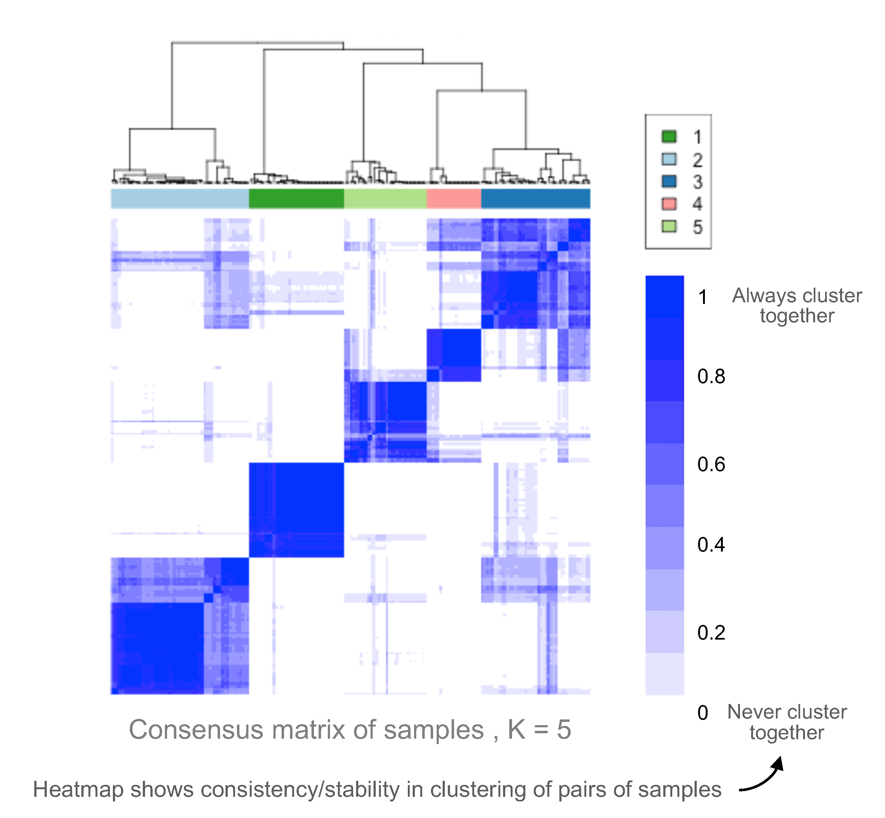
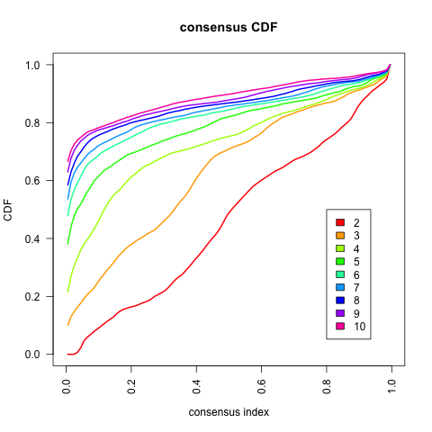
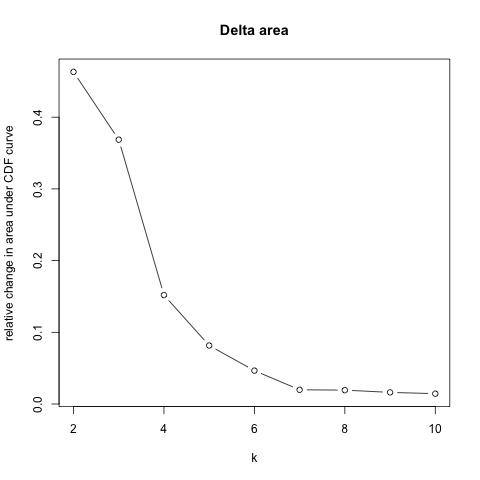

# consensusClustR

[Consensus clustering](https://link.springer.com/article/10.1023/A:1023949509487) is a resampling-based method for discovering robust sample or feature clusters like stable patient subtypes and their (molecular) signatures. It addresses challenges in traditional clustering such as determining the correct number of clusters and assessing their stability.  

## Interpreting Consensus Matrix, CDF, and Delta Area Plots

Consensus clustering evaluates cluster stability across repeated (sample) sub-sampling to identify the optimal number of clusters (`K`). Three visualizations guide this decision:  

### 1. Consensus matrix

The consensus matrix is a heatmap showing how frequently each pair of samples clusters together across all iterations:
- **Values close to 1 (dark blue)**: Highly stable associations showing sample pairs that *always* cluster together  
- **Values close to 0 (white)**: Sample pairs that *never* cluster together and clearly belong to different clusters   
- **Intermediate values**: Sample pairs with ambiguous cluster membership   

   

An ideal consensus matrix has a clear block-diagonal structure with distinct dark squares (stable clusters) and white off-diagonal regions (clear separation). Gradual color transitions indicate unstable or arbitrary cluster boundaries.  

### 2. Cumulative Distribution Function (CDF) Plot

The CDF plot shows the distribution of consensus values (the proportion of clustering iterations in which two samples are assigned to the same cluster) across all sample pairs for each `K` value.  

  

The x-axis represents the consensus values from 0 (samples never cluster together) to 1 (always cluster together); and the y-axis (CDF, 0-1) shows the cumulative proportion of sample pairs with consensus ≤ x.

What do these curves mean?   

- **Initial rise + flat middle + final rise**: Indicates many sample pairs with consensus near 0 and 1 (well-defined, stable clusters), and relatively fewer pairs in the middle (less ambiguity).  
- **Gradual, diagonal line**: Indicates many intermediate consensus values suggesting less consistent cluster separation.  

As `K` increases, changes in the CDF curves can help assess whether additional clusters meaningfully alter the consensus distribution. Curves that become increasingly similar suggest diminishing changes with additional clusters.  

The CDF plot should be interpreted alongside the consensus matrix and delta-area plot rather than used independently to select the optimal K.  

### 3. Delta area or elbow plot

The delta-area plot shows the relative gain in the area under the CDF curve as the number of clusters `K` increases. It can help identify the point where adding more clusters stops providing meaningful improvements.

  

The y-axis represents the relative change in CDF area compared with the previous `K` (for `K ≥ 3`). The value at `K = 2` represents the CDF area itself. Larger values indicate substantial improvements in stability, whereas flattening of the curve suggests diminishing improvements and that adding more clusters may not capture a meaningful data structure.  

**Example interpretation:** In the plot above, `K = 3, 4, 5` were considered candidate solutions based on the delta-area curve. Examination of the consensus matrices and expression heatmaps supported `K = 4,5`. The final selection of `K = 5` was informed by clinical characteristics and survival analyses.  

The optimal number of clusters is evaluated using all these plots and, in practice, they help narrow down the selection to 2-3 candidate `K` values. The final choice must be guided by biological relevance, cluster stability, and reasonable cluster sizes. Meaningful clusters would show distinct molecular or clinical patterns rather than small noisy subgroups.

---

This repo is an R workflow for performing consensus clustering using `ConsensusClusterPlus`   
  - locally, for smaller expression matrices, or
  - on an HPC cluster for large (genomic) data.  

**See `consensusWorkflow.md` (or, if you prefer R, `consensusWorkflow.rmd`) for instructions on running the analysis.**

Right now the workflow is optimized for clustering expression (numeric) data. If features include a mix of categorical and continuous features, you can plug in a custom distance function.  
